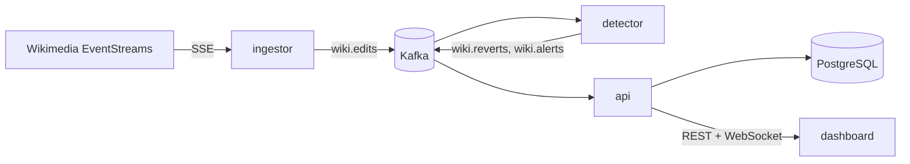

# EditWar Sentinel

EditWar Sentinel detects Wikipedia edit wars, edit bursts and bot spikes in real time. It reads the public Wikimedia `recentchange` stream, processes each edit through Kafka and shows the findings in a live dashboard.

Course: Infraestructura para el Desarrollo Continuo (O2026_ESI3905O), ITESO.



## Repository

| Folder | Content |
|---|---|
| `libs/domain` | Shared contract: events, alerts, rules, topics, settings, telemetry |
| `services/ingestor` | Wikimedia SSE (or recorded replay) to Kafka |
| `services/detector` | Sliding windows, revert classifier, detectors, alerts |
| `services/api` | FastAPI: rules and alerts CRUD, stats, `/ws/live` |
| `dashboard` | React + TypeScript + Vite, served by nginx |
| `deploy` | Docker Compose, k3d cluster, Kustomize overlays (`local`, `dev`, `prod`) |
| `infra` | Terraform for Azure: AKS, Application Insights, Log Analytics, ingress, GitHub OIDC |
| `.github` | Backend, frontend and infra pipelines, PR and issue templates |
| `docs` | Proposal, gap table against the final rubric, Wiki pages |

## Quick start

Requirements: Docker, [uv](https://docs.astral.sh/uv/), Node 22, and for Kubernetes `k3d`, `kubectl` and `helm`.

```bash
make install
make test
```

Docker Compose on recorded events (no internet needed), dashboard at http://localhost:8080:

```bash
EVENT_SOURCE=replay make compose-up
```

Local Kubernetes (k3d with KEDA), dashboard at http://localhost:8088:

```bash
make images cluster deploy
make demo-kill-detector
```

## Documentation

- Wiki pages: [docs/wiki](docs/wiki/Home.md) (architecture, pipelines and branches)
- Deployment and pipelines: [deploy/README.md](deploy/README.md)
- Azure infrastructure: [infra/README.md](infra/README.md)
- Proposal: [docs/EditWar-Sentinel-Propuesta.md](docs/EditWar-Sentinel-Propuesta.md) ([PDF](docs/EditWar-Sentinel-Propuesta.pdf))
- Final rubric against the proposal: [docs/Rubrica-vs-Propuesta.md](docs/Rubrica-vs-Propuesta.md)
- Backlog script: [scripts/crear_backlog.sh](scripts/crear_backlog.sh)
- Contributing (GitFlow, Conventional Commits): [.github/CONTRIBUTING.md](.github/CONTRIBUTING.md)
