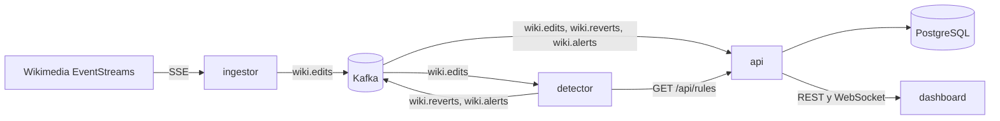
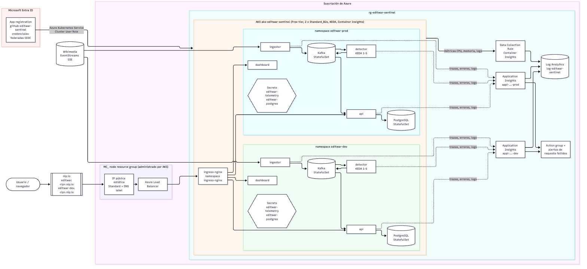
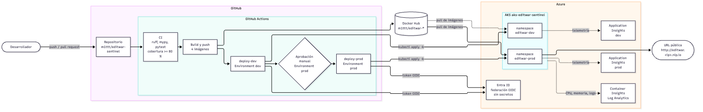

# Arquitectura

## Descripción

El **ingestor** lee el stream `recentchange` de Wikimedia por Server-Sent Events, normaliza cada evento y publica las ediciones del espacio de artículos en el topic `wiki.edits`. El **detector** mantiene una ventana deslizante por artículo, clasifica reversiones y evalúa las reglas de detección. Publica las reversiones en `wiki.reverts` y las alertas en `wiki.alerts`. La **api** guarda las alertas en PostgreSQL, expone el CRUD de reglas y alertas, calcula estadísticas y envía el flujo en vivo por WebSocket. El **dashboard** muestra todo en cuatro paneles.

## Componentes y métodos

| Componente | Clases principales | Archivo |
|---|---|---|
| ingestor | `EventSource`, `WikimediaSSESource`, `ReplayFileSource`, `EventNormalizer`, `EventFilter`, `EventPublisher`, `KafkaEventPublisher`, `IngestorService` | `services/ingestor/src/editwar_ingestor/` |
| detector | `SlidingWindow`, `WindowStore`, `RevertClassifier`, `Detector`, `RevertWarDetector`, `BurstDetector`, `BotSpikeDetector`, `DetectionEngine`, `AlertDispatcher`, `KafkaAlertSink`, `ConsoleAlertSink`, `RuleProvider`, `DetectorService` | `services/detector/src/editwar_detector/` |
| api | `RuleController`, `RuleRepository`, `AlertController`, `AlertRepository`, `AlertConsumer`, `LiveConsumer`, `StatsService`, `WebSocketHub` | `services/api/src/editwar_api/` |
| dominio | `EditEvent`, `RevertEvent`, `Alert`, `DetectionRule` | `libs/domain/src/editwar_domain/` |

Diagramas de clases: [ingesta](https://github.com/m1ttt/editwar-sentinel/blob/main/docs/images/clases-ingesta.png), [detección](https://github.com/m1ttt/editwar-sentinel/blob/main/docs/images/clases-deteccion.png), [API](https://github.com/m1ttt/editwar-sentinel/blob/main/docs/images/clases-api.png).

### Diferencias entre el código y los diagramas de la propuesta

- `DetectionEngine.process(event)` devuelve `ProcessResult(revert, alerts)`, no `list[Alert]`. El motor es dueño del `RevertClassifier`.
- `cooldown_seconds` está en la clase base `Detector`, porque los tres detectores lo usan.
- El motor tiene dos `WindowStore`: uno por artículo y otro por wiki (para `BotSpikeDetector`).
- `AlertSink.send` y `AlertDispatcher.dispatch` son asíncronos.
- El detector lee las reglas de la api con `RuleProvider` (HTTP). Solo la api accede a PostgreSQL.
- La api agrega `LiveConsumer`. Este consumidor no tiene grupo, así que cada réplica de la api recibe todas las ediciones, reversiones y alertas para su WebSocket. `AlertConsumer` usa el grupo compartido `api-alerts` y guarda cada alerta una sola vez.
- `EventPublisher` tiene además `start()` y `close()`. `IngestorService` tiene además `handle(raw)`.
- La api agrega `GeoService`. Pide a la API pública de Wikipedia las coordenadas de los artículos con reversión o alerta, y `LiveConsumer` envía un mensaje `geo` al mapa. La ubicación es la del tema del artículo, no la del editor: el stream de Wikimedia no trae la ubicación de quien edita.

### Patrones de diseño

- Strategy: la jerarquía `Detector`.
- Observer: `AlertDispatcher` con sus `AlertSink`.
- Repository: `RuleRepository` y `AlertRepository` aíslan PostgreSQL.
- Adapter: `EventSource` permite cambiar el stream en vivo por un archivo grabado.

## API

| Método y ruta | Uso |
|---|---|
| `GET/POST /api/rules`, `GET/PUT/DELETE /api/rules/{id}` | CRUD de reglas |
| `GET /api/alerts`, `GET/PATCH/DELETE /api/alerts/{id}` | Consultar, reconocer, descartar y eliminar alertas |
| `GET /api/stats` | Ediciones por segundo, totales y artículos más disputados |
| `GET /api/version` | Versión (`sha-<commit>`) y ambiente desplegados |
| `GET /api/geo/recent` | Últimas reversiones y alertas en artículos con coordenadas, para el mapa |
| `WS /ws/live` | Mensajes `edit`, `revert`, `alert`, `stats` y `geo` |
| `GET /healthz`, `GET /readyz` | Probes de Kubernetes |
| `GET /api/debug/error`, `GET /api/debug/log` | Demo de APM. Activos solo con `ENABLE_DEBUG_ENDPOINTS=true` (local y dev) |

## Stack tecnológico

| Capa | Tecnología |
|---|---|
| Backend | Python 3.12, FastAPI, Uvicorn, httpx, httpx-sse, aiokafka, SQLAlchemy 2 async, Alembic |
| Mensajería | Apache Kafka 3.9 en modo KRaft |
| Base de datos | PostgreSQL 16 |
| Frontend | React 18, TypeScript, Vite, nginx |
| Pruebas | pytest, pytest-asyncio, pytest-cov, Vitest, Testing Library |
| Calidad | ruff, mypy, ESLint, tsc |
| Contenedores | Docker multi-stage, Docker Compose, Docker Hub |
| Orquestación | Kubernetes: k3d en local, AKS en Azure. Kustomize, HPA y KEDA |
| Infraestructura como código | Terraform (azurerm, azuread, helm, kubernetes) |
| CI/CD | GitHub Actions con GitHub Environments `dev` y `prod` |
| Monitoreo | Application Insights con OpenTelemetry, Container Insights y Log Analytics |

## Recursos en Azure

| Recurso | Propósito |
|---|---|
| Resource group | Agrupa todos los recursos del proyecto |
| AKS (2 nodos `Standard_B2s`) | Corre los namespaces `editwar-dev` y `editwar-prod` con KEDA y Container Insights |
| IP pública estática e ingress-nginx | URL pública: `editwar.<ip>.nip.io` (prod) y `editwar-dev.<ip>.nip.io` (dev) |
| Log Analytics workspace | Logs y métricas de contenedores (CPU, memoria) |
| Application Insights (uno por ambiente) | Trazas, errores, requests y mensajes de log |
| Secrets de Kubernetes | Cadena de conexión de Application Insights y credenciales de PostgreSQL, creadas por Terraform |
| Aplicación de Entra ID con credenciales federadas | Login de GitHub Actions en Azure sin secretos (equivale a la service connection de Azure DevOps) |

Kafka y PostgreSQL corren dentro del clúster como StatefulSets. Los equivalentes administrados (Event Hubs con endpoint Kafka y Azure Database for PostgreSQL) cuestan más con créditos de estudiante.

## Diagrama de deployment

## Monitoreo en el portal

- CPU y memoria de nodos y pods: AKS > Monitoring > Insights.
- Requests, fallos y tiempos de respuesta: Application Insights > Performance y Failures.
- Trazas distribuidas: Application Insights > Transaction search.
- Mensajes de log: Application Insights > Logs, tabla `traces`.
